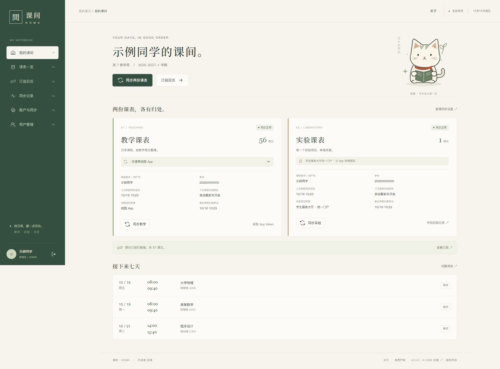
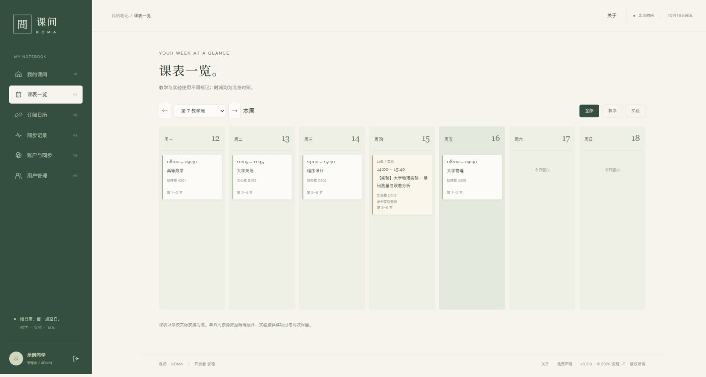
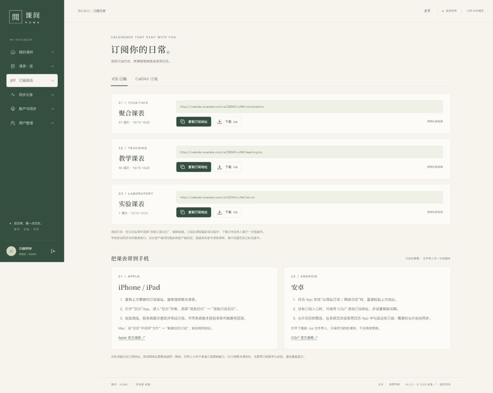
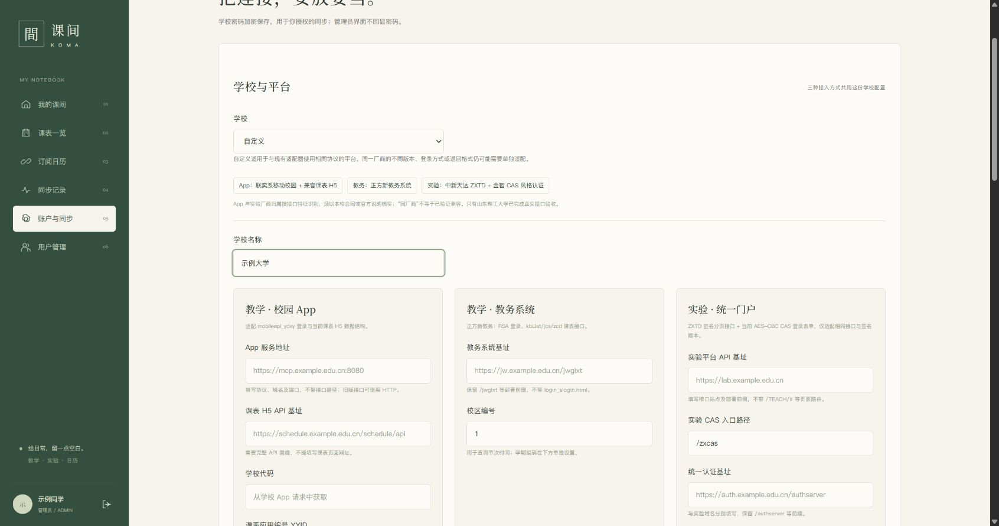
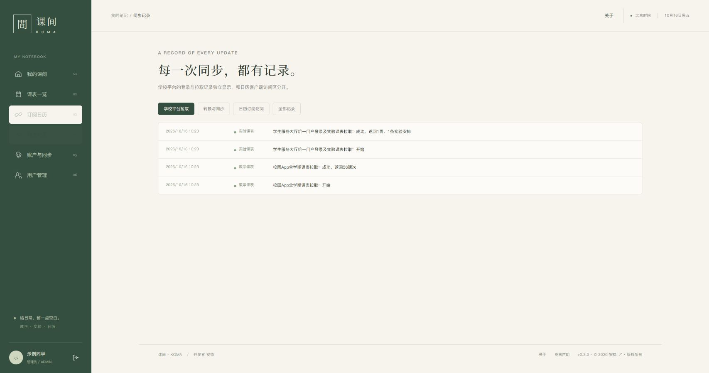
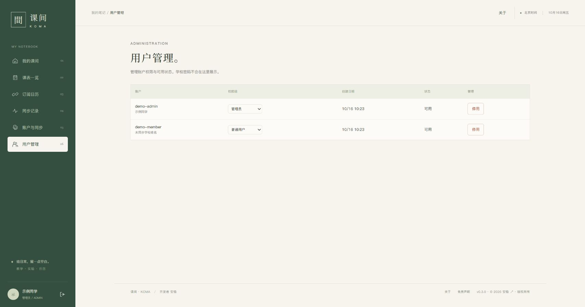
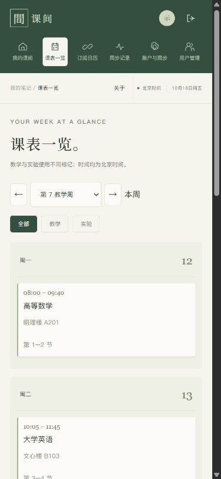
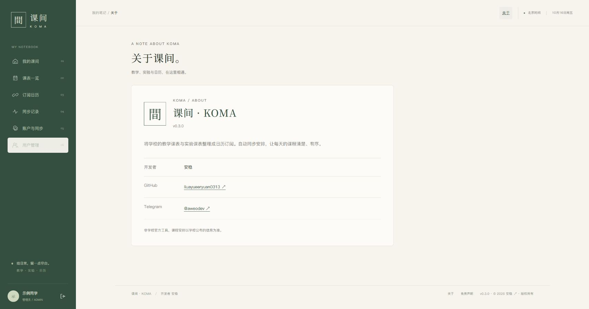

# 课间 · KOMA

将教学课表与实验课表整理成自己的日历订阅。

课间是一款支持 Docker 部署的课表同步工具。你可以通过校园 App、教务系统或实验平台拉取课程，在网页中查看排课，并将教学、实验或聚合课表订阅到手机与电脑日历中。

界面采用纸色、墨绿与留白，配有纸猫动画，提供桌面与移动端布局。

**当前版本：v0.3.0** · **Docker 镜像：[`aweo/koma:latest`](https://hub.docker.com/r/aweo/koma)（支持 linux/amd64、linux/arm64）** · **开发者：[安稳](https://github.com/liuayueeryuan0313)**

**开源许可：[Apache-2.0](LICENSE)** · **项目仓库：[liuayueeryuan0313/KOMA](https://github.com/liuayueeryuan0313/KOMA)** · **Docker Hub：[aweo/koma](https://hub.docker.com/r/aweo/koma)**

> 本项目为非学校官方工具。已完成山东理工大学的实际接入验证；其他学校仅支持相同协议的自定义配置，仍需自行测试。CalDAV 目前只有占位页面，尚未提供服务。

## 目录

- [功能介绍](#功能介绍)
- [平台与兼容范围](#平台与兼容范围)
- [界面预览](#界面预览)
- [快速部署](#快速部署)
- [首次使用](#首次使用)
- [学校账户与平台操作](#学校账户与平台操作)
- [日历订阅与手机导入](#日历订阅与手机导入)
- [自定义学校](#自定义学校)
- [自动更新与日志](#自动更新与日志)
- [数据保存与备份](#数据保存与备份)
- [升级与日常维护](#升级与日常维护)
- [配置项](#配置项)
- [项目结构与开发](#项目结构与开发)
- [常见问题](#常见问题)
- [后续计划](#后续计划)
- [反馈与联系](#反馈与联系)
- [版权与免责声明](#版权与免责声明)

## 功能介绍

### 课表接入

| 功能 | 说明 |
| --- | --- |
| 校园 App 教学课表 | 手动获取并保存 token，后续使用 token 拉取全学期课程 |
| 教务系统教学课表 | 使用学号与教务系统独立密码获取教学排课 |
| 独立实验课表 | 经学校统一门户认证，拉取实验平台全部分页 |
| 教学来源选择 | 支持 App 优先、仅 App、仅教务系统三种模式 |
| 教学故障转移 | App token 缺失或确认失效后，自动模式改用教务系统；实验不参与 |
| 三平台登录与测试 | 每个平台都有独立操作；测试会认证并完整拉取课表，不是只检查网络连通 |
| 自定义学校 | 一个学校下拉框统一控制三种方式，可配置同协议学校的地址与必要参数 |

### 日历与同步

| 功能 | 说明 |
| --- | --- |
| 三种独立订阅 | 教学课表、实验课表、聚合课表分别拥有私密链接 |
| 聚合课表 | 合并当前用户同一学期的教学与实验，排在订阅列表首位 |
| 周期重复 | 连续周使用每周重复，纯单双周使用每两周重复 |
| 调课与例外 | 根据实际排课日期使用排除日期、追加日期或独立事件 |
| 时间与提醒 | 默认北京时间，课程提前 20 分钟提醒，地点包含教室及可获得的教师信息 |
| 自动与手动同步 | 教学、实验可分别设置周期，也可单独或同时手动更新 |
| 最近成功版本 | 登录失败、数据不完整或转换失败时，保留已有成功课表 |
| 时间冲突提示 | 聚合发现重叠安排时提示，不擅自删除任一课程 |
| 客户端缓存 | ICS 提供 ETag 与 304 条件请求支持 |

### 用户与界面

- 支持首次管理员设置、普通用户自行注册及管理员权限管理。
- 每个用户独立保存学校账户、配置、课表、订阅地址与日志。
- 显示学校返回的姓名或用户名、学号、最近学校拉取状态及计划时间。
- 分开展示学校平台拉取、转换同步、日历客户端订阅访问三类日志。
- 站内密码散列保存；学校密码与 App token 加密持久化。

## 平台与兼容范围

内置学校为**山东理工大学**。自定义功能适用于相同接口协议的其他部署，不代表支持所有学校或同一厂商的所有版本。

| 接入方式 | 适用平台 / 承接商类型 | 当前适配范围 |
| --- | --- | --- |
| 校园 App | 联奕系移动校园与兼容课表 H5 | `mobileapi_ydxy` RSA/AES 登录、H5 token 交换、逐周课表接口 |
| 教务系统 | 正方软件新教务系统 | RSA 登录、`jwglxt`、`kbList / jcs / zcd` 排课结构 |
| 实验平台 | 中新天达 ZXTD 系实验教学平台 + 金智 CAS 风格认证 | 当前签名分页接口、CAS 身份交换、AES-CBC 登录表单 |

App、实验及 CAS 的厂商归属包含接口特征推断，应以目标学校官方说明或合同核实；课表 H5 也可能由不同承接商提供。同厂商的路径、认证流程、签名版本和返回字段仍可能不同。

目前不包含旧正方、强智、青果、树维等其他协议的自动适配，也不绕过验证码、短信或额外身份认证。完整参数与证据边界见 [自定义学校说明](docs/CUSTOM_SCHOOLS.md)。

## 界面预览

以下截图来自 v0.3.0 的独立演示环境，姓名、学号、课程、教室和同步记录均为虚构示例；订阅链接是不可用的示例地址。图片统一存放在 `docs/images/`，可按 [截图替换说明](docs/images/README.md) 更新。

### 主界面与课表

我的课间展示教学与实验状态，课表页按教学周查看课程安排。

<!-- SCREENSHOT:overview -->


<!-- SCREENSHOT:timetable -->


### 订阅与学校配置

订阅页区分 ICS 与 CalDAV；学校配置页统一管理学校、教学来源及实验接入。

<!-- SCREENSHOT:subscriptions -->


<!-- SCREENSHOT:school-settings -->


### 同步记录与用户管理

学校拉取与客户端访问分别记录，管理员可管理用户权限和停用状态。

<!-- SCREENSHOT:logs -->


<!-- SCREENSHOT:admin -->


### 移动端与关于

移动端提供纵向课表与平台配置布局；关于页包含项目信息和联系方式。

<!-- SCREENSHOT:mobile -->


<!-- SCREENSHOT:about -->


## 快速部署

### 环境要求

- Docker Engine 或 Docker Desktop；Docker Desktop 使用 **Linux 容器**。
- 支持 `docker compose` 命令的现代 Compose v2 或更高版本。
- 容器需要能访问学校平台；日常打开网页、日历订阅可以在局域网或内网进行，学校同步需要网络连接。
- 正式使用手机订阅时，手机必须能访问部署地址。

推荐使用 **一键脚本部署**（首选），只需一行命令即可全自动完成配置并启动；同时也支持 **手动 Docker Compose 部署**、**离线镜像包加载** 与 **从源码构建**。

### 方式一：一键脚本部署（首选推荐）

在 Linux / macOS / WSL 终端中执行以下一行命令，即可全自动完成环境检测、创建目录、生成配置并拉取镜像启动：

```sh
bash -c "$(curl -fsSL https://raw.githubusercontent.com/liuayueeryuan0313/KOMA/main/install.sh)"
```

> **备选命令**（若系统未安装 curl）：
> ```sh
> bash -c "$(wget -qO- https://raw.githubusercontent.com/liuayueeryuan0313/KOMA/main/install.sh)"
> ```

**脚本自动完成以下工作：**
1. 检查 Docker 及 Docker Compose 运行环境；
2. 自动创建工作目录（默认 `./koma`）并生成预配置的 `compose.yaml`；
3. 智能检测本机局域网 IP 并生成 `.env` 配置文件（支持交互式确认端口与对外访问地址）；
4. 从 Docker Hub 自动拉取官方最新多架构镜像 `aweo/koma:latest` 并启动服务；
5. 输出访问地址、首次管理员设置码（Setup Token）及常用维护命令。

---

### 方式二：手动 Docker Compose 部署

如果你希望手动组织文件与配置，可按以下步骤操作：

#### 1. 准备部署目录与配置文件
新建目录（例如 `koma`），进入目录并创建 `compose.yaml`：

```yaml
name: koma
services:
  komama:
    image: aweo/koma:latest
    init: true
    ports:
      - "${BIND_ADDRESS:-0.0.0.0}:${PORT:-8080}:8080"
    environment:
      PUBLIC_URL: ${PUBLIC_URL:-http://localhost:8080}
      COOKIE_SECURE: ${COOKIE_SECURE:-false}
      ALLOW_REGISTRATION: ${ALLOW_REGISTRATION:-true}
      ADMIN_USERNAME: ${ADMIN_USERNAME:-}
      ADMIN_PASSWORD: ${ADMIN_PASSWORD:-}
    volumes:
      - komama-data:/data
    restart: unless-stopped
    read_only: true
    tmpfs:
      - /tmp:size=96m,mode=1777
    security_opt:
      - no-new-privileges:true
    cap_drop:
      - ALL
volumes:
  komama-data:
```

> **说明**：如需锁定特定版本，可将 `image` 改为 `aweo/koma:0.3.0`。若克隆了仓库源码，根目录已附带该文件。

#### 2. 配置环境变量
在同一目录下创建 `.env` 文件（或下载 `.env.example` 并重命名为 `.env`）：

Linux / macOS：

```sh
curl -O https://raw.githubusercontent.com/liuayueeryuan0313/KOMA/main/.env.example
cp .env.example .env
```

Windows PowerShell：

```powershell
Invoke-WebRequest -Uri https://raw.githubusercontent.com/liuayueeryuan0313/KOMA/main/.env.example -OutFile .env.example
Copy-Item .env.example .env
```

首次创建 `.env` 后按实际部署方式编辑：
- **局域网访问**：将 `BIND_ADDRESS` 设为 `0.0.0.0`，将 `PUBLIC_URL` 设置为部署主机的实际局域网 IP（例如 `http://192.168.1.100:8080`）。
- **仅本机访问**：保持默认 `http://localhost:8080` 即可。

#### 3. 启动并获取管理员设置码
执行以下命令，Docker 会自动拉取镜像并启动：

```sh
docker compose up -d --wait
docker compose exec komama cat /data/setup-token
```

最后一条命令会输出**首次管理员设置码**。打开浏览器访问部署地址（如 `http://localhost:8080` 或实际 IP），点击“管理员设置”填入设置码创建初始管理员账户。管理员创建完成后，设置码自动失效。

---

### 方式三：加载离线镜像包（离线 / 无外网环境）

如使用已提供的离线发布包，按设备架构选择文件：

| 平台 | 离线包 | 内部镜像标签 |
| --- | --- | --- |
| x86-64 / AMD64 | `koma-docker-v0.3.0-linux-amd64.zip` | `koma:0.3.0` |
| ARM64 / AArch64 | `koma-docker-v0.3.0-linux-arm64.zip` | `koma:0.3.0-arm64` |

解压后，使用**包内的 `compose.yaml`**。它已指定镜像并禁止自动拉取，无需再次构建源码。

AMD64：

```sh
docker load -i koma-v0.3.0-linux-amd64.tar
```

ARM64：

```sh
docker load -i koma-v0.3.0-linux-arm64.tar
```

随后复制包内 `.env.example` 为 `.env`，设置访问地址，再启动：

```sh
docker compose up -d --wait
docker compose exec komama cat /data/setup-token
```

ARM64 包不适用于 32 位 ARM 系统。v0.3.0 的 ARM64 镜像已在 x86 主机通过仿真启动检查，尚未在真实 ARM 设备验收。

发布包附有 SHA256 校验文件。Windows 可使用 `Get-FileHash -Algorithm SHA256 文件路径`；Linux 可使用 `sha256sum 文件路径` 核对下载文件。

---

### 方式四：从源码构建（开发者）

适合需要二次开发或自定义修改代码的场景：

```sh
git clone https://github.com/liuayueeryuan0313/KOMA.git
cd KOMA
cp .env.example .env
docker compose up --build -d --wait
docker compose exec komama cat /data/setup-token
```

### 局域网访问

在 `.env` 中设置部署机器的实际局域网地址，例如：

```dotenv
BIND_ADDRESS=0.0.0.0
PORT=8080
PUBLIC_URL=http://192.168.1.100:8080
COOKIE_SECURE=false
```

保存后执行 `docker compose up -d`；从源码首次启动时使用 `docker compose up --build -d --wait`。

`192.168.1.100` 仅为示例，请换成服务器 IP。手机连接同一局域网，并在服务器防火墙放行相应端口。建议为服务器保留稳定的局域网 IP，避免地址变化导致已有订阅无法访问。

`BIND_ADDRESS` 控制监听范围，`PUBLIC_URL` 控制网页生成的订阅地址。手机访问时不能把 `PUBLIC_URL` 配置成 `localhost` 或 `127.0.0.1`，这两个地址会指向手机自身。

### 域名与 HTTPS

使用反向代理部署时，将 `PUBLIC_URL` 设置为完整的 HTTPS 站点地址，并启用安全 Cookie：

```dotenv
BIND_ADDRESS=127.0.0.1
PORT=8080
PUBLIC_URL=https://calendar.example.com
COOKIE_SECURE=true
```

示例适用于反向代理运行在同一主机上的情况；代理在其他容器或主机时，应按实际拓扑调整后端地址。

`PUBLIC_URL` 不带路径，例如不能写成 `https://example.com/koma`。代理应保留 Host、Cookie 与请求头。证书申请与续期交由 Caddy、Nginx 等部署层处理，应用不内置证书申请模块。

进一步说明见 [HTTPS 与证书](docs/HTTPS.md)。

## 首次使用

### 创建管理员

1. 打开部署地址，阅读首次访问的使用说明。
2. 选择“管理员设置”。
3. 填写用户名、站内密码与 `/data/setup-token` 中的一次性设置码。
4. 阅读并同意注册说明，创建首个管理员账户。

站内密码至少 10 个字符。**站内密码与学校密码是两套凭据**，创建站内账户不会自动登录学校平台。

也可在首次启动前配置 `.env` 中的 `ADMIN_USERNAME`、`ADMIN_PASSWORD` 创建管理员；一次性设置码流程可以避免长期保留明文初始管理员密码。已有管理员时，这两个变量不会替代现有账户密码。

### 普通用户注册与权限

普通用户通过“创建账户”注册，随后配置自己的学校账户。

| 权限组 | 能力 |
| --- | --- |
| 普通用户 | 管理自己的学校配置、凭据、课表、同步计划、订阅链接和日志 |
| 管理员 | 具备本人账户功能，并可调整用户权限组或停用账户 |

管理员界面不提供他人学校密码或 token 查询。最后一个管理员不能被停用或降级，以免系统失去管理入口。停用账户后，其会话与订阅失效，自动任务也停止执行。

不开放自行注册时，可设置 `ALLOW_REGISTRATION=false` 并重新创建容器。

## 学校账户与平台操作

### 配置账户

进入“账户与同步”：

1. 选择“山东理工大学”或“自定义”。
2. 填写学号、App / 学生服务大厅统一门户密码、教务系统独立密码。
3. 选择教学来源，核对学期、第一周日期、总周数与教务学期编码。
4. 保存设置，再按需要登录、测试或同步。

内置山理工配置中，App 与实验平台使用同一份门户密码，教务系统使用独立密码；三种方式共用学号。自定义学校须确认符合这一账户模型。

学校与学号不变时，密码输入留空会保留已保存值。更换学号或学校连接参数会清除旧学校凭据、身份、教师缓存和课表，并更换三个订阅链接；仅修改学校显示名称不会清除数据。

### 教学来源模式

| 模式 | 使用方式 |
| --- | --- |
| 优先 App | 优先复用 App token；缺失或失效时转教务系统，需要配置教务密码 |
| 仅校园 App | 只通过已有 token 拉取，不访问教务系统 |
| 仅教务系统 | 直接使用教务系统，不依赖 App token |

实验课表始终单独处理，不属于教学来源选择，也不参与教学故障转移。

### 登录、测试、同步有什么区别

| 操作 | 用途 | 是否更新已发布订阅 |
| --- | --- | --- |
| App“登录获取 token” | 明确确认后登录 App，获取并加密保存 token | 否 |
| 教务 / 实验“登录” | 保存当前填写的配置与凭据，验证对应学校认证并获取身份 | 否 |
| “测试课表拉取” | 用当前表单配置验证认证、完整拉取与转换，显示身份、课次数或失败原因 | 否 |
| 手动 / 自动同步 | 按已保存的配置拉取、转换并发布成功版本 | 是 |

测试使用临时输入，不保存测试凭据或学校配置。目的学校没有改变时，留空的凭据可沿用已保存值；目的学校改变时，不会把旧学校凭据发送给新站点，需要重新填写。

教务登录验证可能读取课表查询中的身份信息，但“测试拉取”与“同步”才会校验完整课表。测试通过不等于订阅已更新，仍需执行同步。

### App token 与手机登录

**App 登录只用于获取 token，不是每次拉取的前置步骤。**

- 已有 token 时，可直接粘贴并保存。
- 没有 token 时，手动点击“登录获取 token”。该操作可能使手机 App 会话退出，界面会先提示确认。
- App 测试、手动同步和定时更新都复用 token，不自动重新登录获取新 token。
- token 确认失效后保存失效标记；App 优先模式的后续同步直接使用教务系统，直到手动获取或填写新 token。仅 App 模式会报告失败，不转教务系统。
- 普通网络错误不会被误判成 token 失效，也不会因此触发故障转移。

在 App 优先模式中，如果缺少教师信息且配置了教务密码，程序可能在排课完全一致的前提下读取教务记录补全教师；这不改变 App 作为教学排课来源的优先级。缺失的教师不会被编造。

## 日历订阅与手机导入

### 选择一份订阅

进入“订阅日历 → ICS 订阅”，按需要选择：

| 订阅 | 内容 |
| --- | --- |
| 聚合课表 | 当前用户同一学期的教学与实验；需要两份源课表均成功生成 |
| 教学课表 | 来自当前教学来源的正常课程 |
| 实验课表 | 实验平台返回的实验课程与项目 |

只需要教学或实验时，直接订阅对应的一份。如果已订阅聚合课表，一般无需再订阅教学与实验，避免重复显示。

首次同步成功后复制对应私密链接。**使用“添加订阅日历”才能持续读取新版本；下载 `.ics` 后导入只是一次性副本。**

### iPhone / iPad

1. 复制需要的订阅地址。
2. 打开“日历”App，进入“日历”列表。
3. 选择“添加日历 → 添加订阅日历”。
4. 粘贴链接，按系统提示查找并完成订阅。
5. 在日历列表中确认该订阅已勾选。

不同系统版本的按钮名称可能略有区别。参考 [Apple 官方订阅说明](https://support.apple.com/zh-cn/guide/iphone/iph3d1110d4/ios)。

### Mac

在“日历”App 中选择“文件 → 新建日历订阅”，粘贴同一地址，并按需要设置刷新选项。

### 安卓

1. 日历 App 提供“从网址订阅 / 网络日历”时，直接添加链接。
2. 没有订阅入口时，可使用 [ICSx⁵](https://icsx5.bitfire.at/) 添加地址并设置刷新间隔。
3. 允许所需日历权限，在系统日历或常用日历 App 中勾选新订阅。
4. 如后台同步受限，按手机设置允许订阅应用在后台运行。

安卓厂商和日历应用的入口不同，不能保证系统日历原生支持 ICS 网址订阅。只打开下载文件导入，不会持续同步。

### 重复、时区与提醒

- 课程使用 `TZID=Asia/Shanghai` 并附 `VTIMEZONE`，以北京时间表示。
- 连续周课程采用每周 `RRULE`；纯单双周采用 `INTERVAL=2`。
- 不连续周、停课与调课根据实际日期处理，不统一强制每周重复。
- 每个事件包含提前 20 分钟的 `DISPLAY` 提醒。
- 地点包含教室与学校返回的教师；实验课程使用“【实验】”标记。

单次实验或特殊调课显示为独立事件属于正常情况。日历客户端是否显示 “repeats weekly”、GMT 标签，及是否实际弹出通知，仍由客户端的界面、权限与设置决定。

### CalDAV

CalDAV 标签当前仅显示**“正在开发，敬请期待”**，未提供 CalDAV 地址、账号、DAV 路由或双向同步。现阶段请使用 ICS 订阅。

## 自定义学校

进入“账户与同步 → 学校与平台”，将学校选择为“自定义”。该设置对当前用户的三种接入方式共同生效，不影响其他用户。

| 平台 | 主要参数 |
| --- | --- |
| 校园 App | App 服务地址、课表 H5 API 基址、学校代码、YYID、token 交换路径、客户端版本 |
| 教务系统 | 含部署前缀的系统基址、校区编号；学期编码在学期设置中填写 |
| 实验平台 | 实验 API 基址、实验 CAS 入口路径、统一认证基址 |

地址不仅是域名：需要保留协议、必要端口和 `/jwglxt`、`/schedule/api`、`/authserver` 等部署前缀。不要填写 `#/` 前端路由或带登录凭据的链接。

只配置自己使用的平台即可。仅使用已有 App token 时只需课表 H5 基址；手动获取 token 还需 App 登录参数。未配置的平台会提示未配置，不会回退访问山东理工大学。

### 核对学期与作息

内置默认学期为 `2026-2027-1`，第一周星期一为 `2026-08-31`，总计 20 周，结束于 `2027-01-17`。这些是山理工参考配置，不代表其他学校或后续学期的实际安排。

自定义学校应核对本校学期、周数、教务学期编码及“核对本校作息时间”中的内容。编辑格式为每行“节次 开始时间 结束时间”，例如：

```text
1 08:00 08:45
2 08:55 09:40
11-12 21:05 22:45
```

教学与实验共用时间表。山理工默认只提供第 11–12 节合并的 `21:05–22:45`，没有猜测单独第 11 节结束与第 12 节开始；如本校存在这些单节安排，应补齐实际时间。修改作息后需重新同步，已有订阅不会仅因保存设置而重新转换。

自定义域名须解析到公开地址，不支持指向本机、内网或保留地址的自定义目的地址。认证只允许配置中的域名，不接受未配置的跨域跳转。出现验证码、短信或额外验证时会停止并保留旧课表。

详细示例见 [自定义学校说明](docs/CUSTOM_SCHOOLS.md)。

## 自动更新与日志

教学与实验可分别开启每 30 分钟、每小时、每 6 小时、每 12 小时或每天自动更新，也可以关闭自动更新，仅手动同步。

计划只在服务运行时执行；关闭电脑、停止容器或 Docker 引擎未运行时不会同步。重启服务后会处理到期任务。

### 两个不同的更新过程

```text
学校平台 → 课间拉取与转换 → 发布最新 ICS → 日历客户端按自身频率刷新
```

课间完成学校同步，不代表手机日历已经刷新。客户端刷新频率不由本项目控制。

| 显示 / 日志 | 含义 |
| --- | --- |
| 最近学校拉取尝试 | 最近向学校发起同步的时间，成功或失败均记录 |
| 上次学校同步成功 | 学校拉取、转换并发布成功的时间，失败不覆盖 |
| 下次学校自动同步 | 服务计划再次向学校拉取的时间 |
| 平台登录 / 测试时间 | 对应按钮的检查时间，不替代学校同步成功时间 |
| 学校平台拉取日志 | 登录、查询、分页、返回条数或失败 |
| 转换与同步日志 | 归一化、故障转移、合并与发布 |
| 日历订阅访问日志 | 日历客户端获取 ICS 或发送 304 条件检查 |

故障转移成功时，教学区域显示警告及当前来源；故障转移失败时显示原因，并继续提供最近成功版本。普通网络故障、空课表、不完整实验分页或时间校验失败均不会覆盖成功课表。

目前没有邮件、Webhook 或系统推送渠道；订阅访问记录不能证明设备已显示课程或弹出提醒。

## 数据保存与备份

### 数据存在哪里

后端使用 **SQLite**，无需额外部署 MySQL。容器内持久化目录为 `/data`：

| 文件 / 数据 | 用途 |
| --- | --- |
| `komama.sqlite3` | 用户、学校配置、加密凭据、课表、ICS、订阅链接、计划、状态与日志 |
| `master.key` | 解密学校凭据、token 与私密链接所需的主密钥 |
| SQLite WAL / SHM 文件 | 运行时可能产生的辅助文件，应随完整数据目录保留 |
| `setup-token` | 首次管理员设置码，完成首次设置后失效 |

Compose 声明 `komama-data` 持久卷；默认项目名为 `koma`，实际卷名通常是 `koma_komama-data`。使用自定义项目名或外部挂载时，以部署配置为准。

重启或更新容器不会自动删除持久卷。镜像和源码包不包含你的运行数据库、学校密码、token 或个人课表。

### 密码如何保存

- 站内登录密码使用 **scrypt 加盐散列**，不保存可直接还原的明文。
- 学校密码、App token 和私密链接使用 **AES-256-GCM** 加密保存。
- 用户名、课表、学校身份、配置与日志按数据库记录保存；这不是整个数据库文件的透明加密。
- `master.key` 与数据库在同一数据目录；获得主机与完整目录控制权的人仍可能读取其中信息。

私密订阅链接支持无登录日历客户端，持有完整链接即可读取课表。更换链接会使旧链接失效，需要在客户端重新添加。

### 备份

建议先停止服务，再完整复制 `/data`，避免写入过程中只复制数据库主文件：

```sh
docker compose stop
docker compose cp komama:/data/. ./koma-backup
docker compose start
```

确认备份中同时存在数据库和 `master.key`，并保存部署使用的 `.env` 与 Compose 配置。实际备份应存放在受保护的位置，定期复制到另一设备；本项目不自动创建定时备份。

> **数据库和密钥必须一起备份。** 丢失 `master.key` 后，无法恢复原有加密凭据与私密链接。不要把备份、`.env`、原始抓包或私密订阅地址提交到 GitHub。

### 迁移与恢复

1. 停止源服务并完成备份。
2. 在目标设备加载对应架构镜像，准备数据卷或挂载目录。
3. 在目标服务启动前，将**完整数据目录**恢复到 `/data`，保留原数据库与 `master.key`。
4. 确保容器用户 UID/GID `10001` 可读取密钥并写入数据目录。
5. 更新目标环境的 `PUBLIC_URL`，启动后核对账户、三份课表与订阅。

更换服务器域名或 IP 后，客户端中原地址不会自动改变，需要重新添加新地址。不要把旧密钥覆盖到另一份不匹配的数据库上。

“清除学校凭据”会移除已保存的学校密码和 token，不等同于删除已有成功课表或停止订阅；如不再同步，还应关闭对应自动计划。

## 升级与日常维护

### 从 Docker Hub 升级（推荐）

先备份数据（详见下方备份章节），然后拉取最新镜像并重新启动即可完成平滑升级。数据卷 `komama-data` 会自动保留：

```sh
docker compose pull
docker compose up -d --wait
```

### 从源码升级

更新源码后重新构建并启动：

```sh
git pull
docker compose up --build -d --wait
```

### 从离线包升级

加载新版本镜像，更新 Compose 中的镜像标签，再启动：

```sh
docker load -i koma-v0.x.x-linux-xxx.tar
docker compose up -d --wait
```

保持原项目名和数据挂载；如果项目名、卷名或挂载目录改变，可能启动一份空数据库。首次设置页面意外重新出现时，应先核对挂载。

### 常用命令

| 操作 | 命令 |
| --- | --- |
| 查看容器状态 | `docker compose ps` |
| 查看最近服务日志 | `docker compose logs --tail=100 komama` |
| 持续查看服务日志 | `docker compose logs -f komama` |
| 停止 / 恢复 | `docker compose stop` / `docker compose start` |
| 重启服务 | `docker compose restart` |

健康检查接口为 `GET /healthz`，正常返回 `status: ok` 和版本号。它用于检查应用运行，不代表学校账号已验证或课表已同步。

**不要使用 `docker compose down -v` 升级应用**，该选项会删除持久卷。本版按单实例设计，不支持多个应用副本同时操作同一数据库。

## 配置项

### Docker / Compose

| 变量 | 默认值 | 说明 |
| --- | --- | --- |
| `BIND_ADDRESS` | Compose 默认：`0.0.0.0`（允许局域网访问；如仅本机可设为 `127.0.0.1`） | 宿主机监听地址 |
| `PORT` | `8080` | 宿主机映射端口 |
| `PUBLIC_URL` | `http://localhost:8080` | 用户和日历客户端可访问的完整站点地址，不带路径 |
| `COOKIE_SECURE` | `false` | HTTPS 部署设为 `true`，纯 HTTP 部署保持 `false` |
| `ALLOW_REGISTRATION` | `true` | 是否允许普通用户自行注册 |
| `ADMIN_USERNAME` | 空 | 可选，仅首次初始化管理员时使用 |
| `ADMIN_PASSWORD` | 空 | 可选初始管理员密码，不用于重置已有账户 |

修改 `.env` 中的端口、访问地址等配置后，执行 `docker compose up -d` 重新创建容器；仅 `restart` 不会重新应用这些配置。

### 本地 Python 运行

| 变量 | 默认值 / 用途 |
| --- | --- |
| `DATA_DIR` | 默认项目内 `data/`，指定数据库及密钥目录 |
| `HOST` | 默认 `127.0.0.1`，Python 服务监听地址 |
| `PORT` | 默认 `8080`，Python 服务端口 |
| `NODE_BIN` | Node.js 可执行文件路径；未设置时从 PATH 查找 |
| `PUBLIC_URL` | 生成订阅地址使用的站点 origin |

Python 直接运行不会自动读取 Compose 的 `.env` 文件，应由运行环境设置变量。`BIND_ADDRESS` 是 Compose 的宿主机端口配置，本地 Python 应使用 `HOST`。

## 项目结构与开发

### 技术栈

| 层次 | 技术 |
| --- | --- |
| 前端 | 原生 HTML、CSS、JavaScript、SVG 动画，无 npm 构建步骤 |
| Web 后端 | Python HTTP 服务 |
| 数据 | SQLite |
| 凭据保护 | scrypt、AES-256-GCM |
| 学校适配 | Node.js，凭据通过进程标准输入传递 |
| 日历转换 | Python 归一化、重复规则与 ICS 编译 |
| 部署 | Docker、Compose、持久卷 |

### 目录结构

```text
.
├── README.md                     # 项目主页与使用说明
├── LICENSE                       # 版权声明
├── Dockerfile                    # 镜像构建
├── compose.yaml                  # 容器部署配置
├── install.sh                    # 一键安装与部署脚本
├── .env.example                  # 环境变量示例
├── requirements.txt              # Python 依赖
├── server.py                     # WebUI、账户 API、ICS 服务
├── core.py                       # SQLite、账户、加密与权限
├── sync.py                       # 手动任务、调度、教学故障转移
├── school_profiles.py            # 学校目的地址与作息校验
├── start-local.ps1               # Windows 本地启动
├── web/                          # 页面、样式、交互与纸猫 SVG
├── adapters/
│   ├── school-defaults.json      # 内置学校服务参数
│   ├── school_bridge.mjs         # Python 与 Node 适配入口
│   ├── config.json               # 默认学期、作息及转换设置
│   ├── jw-request.json           # 正方请求结构
│   └── scripts/                  # 认证、拉取及 ICS 转换
├── tests/                        # Python 与 Node 测试
└── docs/
    ├── ARCHITECTURE.md           # 实现与 HTTP 接口
    ├── CUSTOM_SCHOOLS.md         # 自定义参数和兼容边界
    ├── HTTPS.md                  # HTTPS 部署说明
    ├── VALIDATION.md             # 验收范围与记录
    ├── GITHUB_PUBLISHING.md       # 维护者上传与发布检查
    └── images/                   # 截图目录及插图说明
```

### 本地运行

建议使用 Python 3.12、Node.js 24，与 Docker 镜像保持一致。在项目根目录执行：

```sh
python -m pip install -r requirements.txt
python server.py
```

首次管理员设置码默认写入 `data/setup-token`。Windows 也可使用：

```powershell
powershell -ExecutionPolicy Bypass -File .\start-local.ps1
```

该脚本默认监听本机。如需本地 Python 服务被其他设备访问，应直接配置 `HOST`、`PORT`、`PUBLIC_URL` 后运行 `server.py`。

### 测试与验收

```sh
python -m unittest discover -s tests -v
node --test tests/test_school_profiles.mjs
node --check web/app.js
node --check adapters/school_bridge.mjs
```

v0.3.0 记录为 30 项 Python 测试、11 项 Node 测试通过；新增学校设置及订阅标签在 320、390、430 像素宽度下完成排版检查。

测试使用合成账号与模拟学校响应，不会靠单元测试登录真实学校。其他学校真实认证、生产负载、真实 iPhone Safari 和真实 ARM 设备尚未完成验收。详见 [验收记录](docs/VALIDATION.md)。

## 常见问题

<details>
<summary>手机打不开页面，或者无法订阅怎么办？</summary>

检查手机是否能在浏览器中打开 `PUBLIC_URL`、是否连接同一局域网、服务器是否监听局域网地址及防火墙是否放行。手机不能使用服务器的 localhost 地址。服务器或 Docker 引擎停止后，日历也无法获取新版本。

</details>

<details>
<summary>学校课表更新了，为什么手机还没有变化？</summary>

先看“上次学校同步成功”是否更新，再看“日历订阅访问”是否有客户端访问。学校拉取与客户端刷新是两个过程。如果导入的是下载文件，则不会自动更新，应改为订阅链接。

</details>

<details>
<summary>App token 失效后会反复登录、把手机 App 顶下线吗？</summary>

不会自动重新登录 App。自动模式记录失效后转教务，后续同步不再尝试 App，直到手动更新 token。用户主动点击“登录获取 token”仍可能影响手机会话，操作前会有提示。

</details>

<details>
<summary>测试成功，但订阅内容没有变化？</summary>

测试只验证当前配置、认证与完整拉取，不发布订阅。保存正确配置后，再执行教学或实验同步。

</details>

<details>
<summary>自定义学校是不是改一个域名就能使用？</summary>

不一定。必须是当前适配的协议；App 还需要学校代码、YYID 与 H5 交换信息，实验需要独立认证地址及相同签名版本。不同平台或认证结构变化需要新增适配。

</details>

<details>
<summary>为什么聚合订阅还不可用？</summary>

聚合需要教学和实验两份课表均成功生成，且学期与配置能合并。只需要其中一份时，使用独立订阅即可；查看同步日志了解合并失败原因。

</details>

<details>
<summary>升级后又出现首次设置页面？</summary>

先检查是否换了 Compose 项目名、数据卷或挂载目录，是否启动了一份空数据库。不要立即覆盖原数据；找到匹配的数据库与密钥后恢复挂载。

</details>

<details>
<summary>是否支持 CalDAV、自动识别新学期或邮件推送？</summary>

当前均未实现。CalDAV 只有占位；新学期需手动修改设置；日志与页面提示不等同于邮件、Webhook 或系统推送。

</details>

## 后续计划

以下为待完善方向，不属于 v0.3.0 已实现能力，也不承诺具体交付时间：

- CalDAV 订阅能力。
- 更多学校与平台协议的实际适配验证。
- 真实移动设备与 ARM 设备验收。
- 根据实际反馈完善部署、交互与错误提示。

## 反馈与联系

- 开发者：**安稳**
- GitHub：[liuayueeryuan0313](https://github.com/liuayueeryuan0313)
- Telegram：[@aweodev](https://t.me/aweodev)

反馈时请说明版本、部署方式、CPU 架构、教学来源、发生时间、操作步骤及脱敏后的错误提示。可在本仓库开启 Issues 后提交问题，或通过上述方式联系。

不要在公开 Issue 中附学校密码、token、Cookie、Authorization、完整私密订阅链接或原始 HAR。适配建议请提供不含凭据和个人信息的接口结构及厂商版本说明。

维护者上传 GitHub、补充截图和发布离线包的步骤见 [GitHub 发布说明](docs/GITHUB_PUBLISHING.md)。

## 版权与免责声明

Copyright 2026 [安稳](https://github.com/liuayueeryuan0313)。本项目采用 **Apache License 2.0**，完整条款见 [LICENSE](LICENSE)，署名信息见 [NOTICE](NOTICE)。依赖组件遵循各自许可证。

本项目非学校官方服务。仅用于整理本人有权访问的课表，不替代学校教务通知。课程、实验、调课、停课及考试安排以学校公布的信息为准。

学校认证策略、网络条件与接口变更可能影响同步。请自行核对重要安排，并妥善保管站内账户、学校凭据、数据库、密钥与私密订阅链接。
